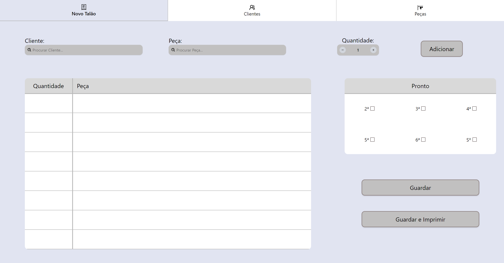
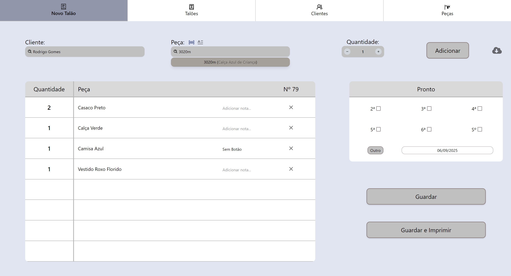
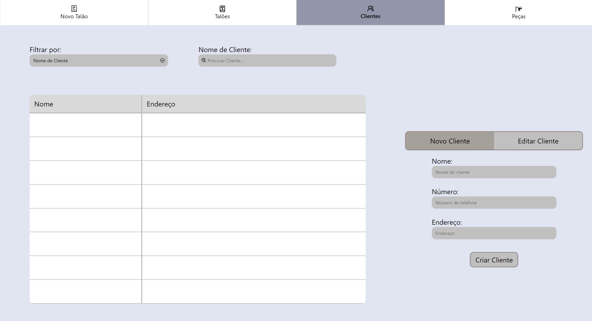
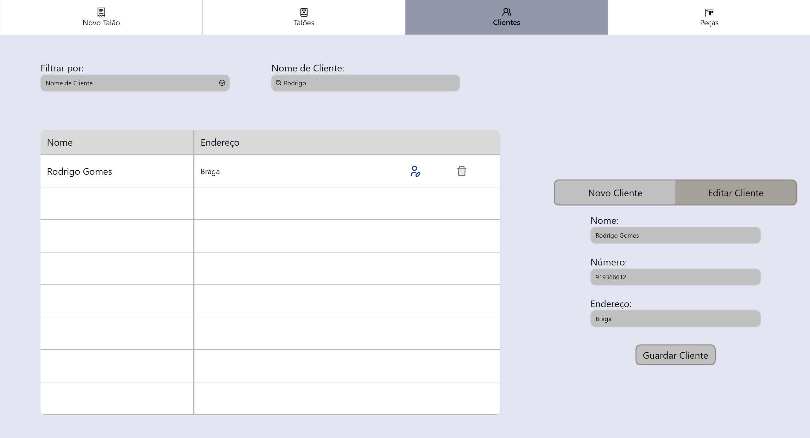
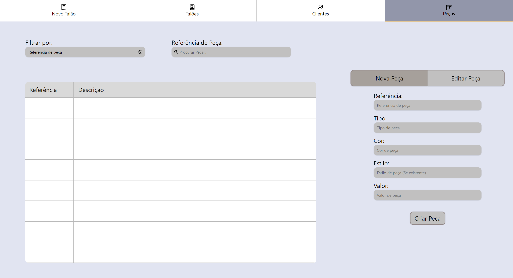
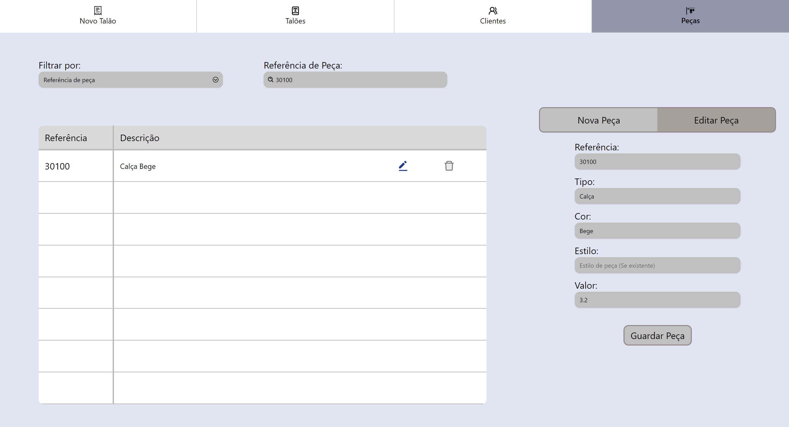

# WashWise - Laundry Management App

WashWise is a desktop application for laundry management, built with Electron and React. This is the **multi-workstation edition**: several counters work at the same time against a shared server, so every receipt, customer and item is the same on all of them.

> Looking for the standalone edition (one computer, local SQLite database, no server)? See the [`SinglePC`](https://github.com/RodG23/WashWise/tree/SinglePC) branch.

## Architecture

- **Desktop client** (this repository) - Electron + React + Tailwind CSS, installed on each workstation
- **Server** (separate, private repository) - Fastify REST API + PostgreSQL, running in Docker on the shop's local network
- **Mutual TLS** - the client and the server authenticate each other with certificates issued by the shop's own certificate authority; nothing is exposed to the internet
- **Safe concurrent editing** - records carry a version number, so two workstations editing the same receipt or customer never silently overwrite each other
- **Server status banner** - the app warns when the server cannot be reached instead of failing silently

## Features

- **Customers** - add, edit and search by name or phone number; customers can be flagged as *"no receipt"*, which prints a name label instead of the usual number ticket
- **Items** - catalogue of garments and services with reference, type, colour, style and price
- **Orders** - receipts numbered per year, with quantity, notes per item and paid/pending/collected states
- **Pick-up date** - choose a weekday (with modifiers such as *"without fail"*) or an exact date from a calendar, with a `+7` shortcut
- **Search and filters** - by receipt number, customer, phone, date range, year, state, marking and pick-up day
- **Order marking** - tick receipts to keep track of them while working through a list
- **Search inside an order** - find an item by description or note in large orders
- **Printing** - ESC/POS thermal printing of the full receipt, number label and free text with up to 100 copies
- **One-click database backup** on the server


## Screenshots

### New Order Tab (empty state)

Initial screen to create a new order, search for customers and items, add products and define the ready-for-pickup day.



### New Order Tab (with items added)

Displays customer and item selection, quantity, optional notes per item, and pick-up day selection. The "Save and Print" button generates and prints the receipt automatically.



### Client Management Tab

Displays customer management with search and filter functionality. The table lists registered customers, while the side panel allows creating or editing customer records with name, phone number, and address details.





### Product Management Tab

Displays item management with search and filter functionality. The table lists existing items, while the side panel allows creating or editing entries with reference, type, color, style, and value.





## How to run (for development)

The client needs a running WashWise server and a client certificate. Neither is part of this repository.

1. Clone the repository:
```bash
git clone https://github.com/RodG23/WashWise.git
```

2. Install dependencies:
```bash
cd washwise-app
npm install
```

3. Place the client certificates in `washwise-app/certs/` (`ca.crt.pem`, `client.crt.pem`, `client.key.pem`). This folder is ignored by Git and must never be committed.

4. Start the server locally. In development the app connects to `https://127.0.0.1:5050`.

5. Run Frontend:
```bash
npm run dev
```

6. Run desktop app:
```bash
npm run electron
```
<br/>

## How to install

There is no public installer for this edition: it only works together with the shop's private server and certificates.

For a ready-to-use installer of the standalone edition, see the [`SinglePC` releases](https://github.com/RodG23/WashWise/releases/tag/eng-v1.2.0).


---

WashWise is designed to simplify and streamline laundry business operations.


